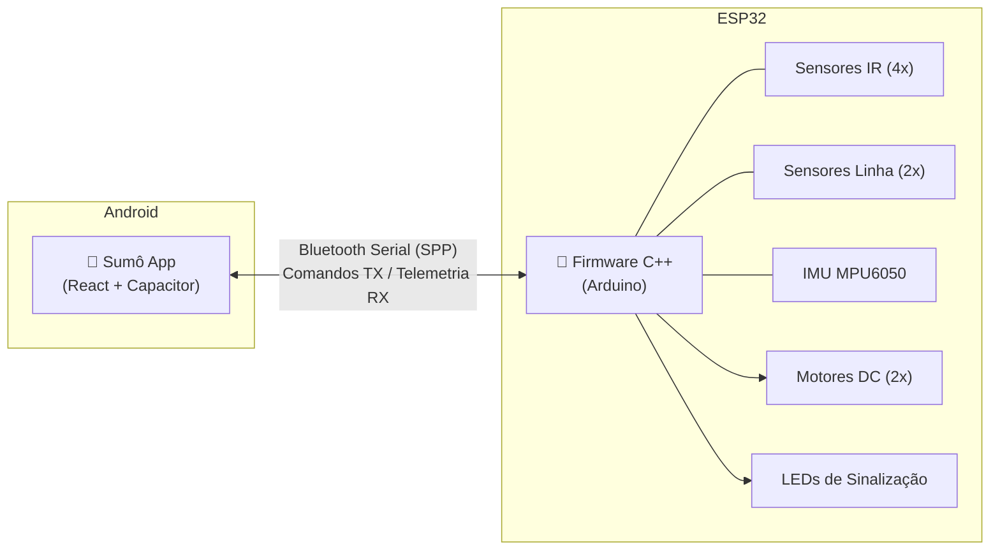

<


</div>

---

Aplicativo mobile Android que se conecta via Bluetooth Serial (SPP) a um robô de sumô autônomo baseado em ESP32, oferecendo **visualização de sensores em tempo real**, **seleção de estratégias de combate**, **calibração dinâmica de parâmetros** e **console serial integrado** — tudo em uma interface dark industrial otimizada para uso durante competições e testes em arena.

---

## 📋 Índice

- [Funcionalidades Principais](#-funcionalidades-principais)
- [Arquitetura do Sistema](#-arquitetura-do-sistema)
- [Protocolo de Comunicação](#-protocolo-de-comunicação)
- [Stack Tecnológica](#-stack-tecnológica)
- [Estrutura do Repositório](#-estrutura-do-repositório)
- [Guia de Instalação e Execução](#-guia-de-instalação-e-execução)
- [Design System](#-design-system)
- [Créditos e Licença](#-créditos-e-licença)

---

## ✨ Funcionalidades Principais

### 📡 Telemetria (Aba 1)

| Recurso | Descrição |
|---------|-----------|
| **Radar de Oponente** | Silhueta SVG do robô com 4 feixes IR animados (2 frontais + 2 laterais) que acendem em tempo real ao detectar oponente |
| **Sensores de Linha** | 2 pontos SVG nas pontas da lâmina que pulsam em vermelho ao detectar borda branca (limiar ≤ 400 ADC) + barras de progresso com valor analógico |
| **Horizonte Artificial (IMU)** | Widget 2D Gyro com bolha de inclinação dinâmica simulando pitch/roll do MPU6050 |
| **Indicadores Inerciais** | Barras de sensibilidade de parada e empurrão com valores em m/s² |
| **Parada de Emergência** | FAB flutuante vermelho que envia `PARADA*` ao ESP32 imediatamente |

### ⚔️ Estratégias de Combate (Aba 2)

| Recurso | Descrição |
|---------|-----------|
| **7 Estratégias Pré-configuradas** | Radar, Caçador, Firula, Suicida, Só Vai, Contorno, Segue Linha |
| **Seleção por Card** | Card inteiro é clicável — sem botões redundantes. Estratégia ativa recebe borda indigo brilhante e badge `SELECIONADA` |
| **Classificação de Risco** | Cada estratégia exibe um nível de perigo: Seguro, Balanceado, Agressivo ou Extremo |
| **Transmissão Imediata** | Ao tocar no card, o comando `EST,<id>*` é enviado instantaneamente ao ESP32 |

### 🎛️ Calibração Dinâmica (Aba 3)

| Recurso | Descrição |
|---------|-----------|
| **Velocidade de Reta** | Slider + input numérico (0–255 PWM) com envio via `VR,<pwm>*` |
| **Velocidade de Giro** | Slider + input numérico (0–255 PWM) com envio via `VG,<pwm>*` |
| **Toggle de Evasão** | Switch on/off para habilitar manobra de evasão inercial (`HBE,<0\|1>*`) |
| **Limiares IMU** | Inputs numéricos para sensibilidade de parada e empurrão em m/s² |
| **Teste de Motores** | D-Pad direcional (Frente/Ré/Esquerda/Direita/Parar) com indicadores de PWM % em barras verticais para cada motor |
| **Salvar Parâmetros** | Botão fixo no rodapé que transmite todos os valores calibrados ao robô de uma vez |

### 💻 Console Serial (Aba 4)

| Recurso | Descrição |
|---------|-----------|
| **Terminal Full-height** | Log ocupa 100% da altura vertical disponível entre header e input |
| **Histórico Bidirecional** | Mensagens TX (indigo ↗) e RX (verde ↙) com timestamp |
| **Envio Manual** | Campo de texto + botão para enviar comandos arbitrários ao ESP32 |
| **Auto-scroll** | Scroll automático ao receber novas mensagens |

### 🔄 Navegação por Gestos

- **Swipe Left/Right** entre abas com transição animada (Framer Motion)
- **Prevenção de conflito**: gestos ignorados sobre sliders, D-Pad e área de scroll do console via `data-prevent-swipe`
- **Limiar de sensibilidade**: deslocamento mínimo de 70px horizontal com dominância sobre eixo Y

---

## 🏗️ Arquitetura do Sistema



### Fluxo de Dados

```
┌─────────────┐     TX: "VR,220*"      ┌──────────────┐
│             │ ──────────────────────▶ │              │
│  Sumô App   │                         │    ESP32     │
│  (Android)  │ ◀────────────────────── │  (Firmware)  │
│             │     RX: "220|180|1|..." │              │
└─────────────┘                         └──────────────┘
```

1. O App envia **comandos de texto** terminados em `*` via Bluetooth Serial
2. O ESP32 processa o comando, executa a ação (motor, estratégia, EEPROM) e responde
3. A cada 500ms, o App solicita telemetria com `dados*`
4. O ESP32 responde com uma string pipe-separated contendo 12 campos

---

## 📡 Protocolo de Comunicação

### Comandos TX (App → ESP32)

| Comando | Formato | Descrição | Exemplo |
|---------|---------|-----------|---------|
| Solicitar Telemetria | `dados*` | Requisita string de telemetria completa | `dados*` |
| Definir Estratégia | `EST,<id>*` | Seleciona rotina de combate (1–7) | `EST,3*` |
| Velocidade de Reta | `VR,<pwm>*` | Define PWM dos motores em linha reta (0–255) | `VR,220*` |
| Velocidade de Giro | `VG,<pwm>*` | Define PWM dos motores em rotação (0–255) | `VG,180*` |
| Toggle Evasão | `HBE,<flag>*` | Habilita (1) ou desabilita (0) evasão inercial | `HBE,1*` |
| Limiar de Parada | `LIP,<val>*` | Define sensibilidade de detecção de parada (m/s²) | `LIP,0.1*` |
| Limiar de Empurrão | `LIE,<val>*` | Define sensibilidade de detecção de empurrão (m/s²) | `LIE,-0.25*` |
| Parada de Emergência | `PARADA*` | Corta todos os motores imediatamente | `PARADA*` |

### Payload RX (ESP32 → App)

Formato: string de 12 campos separados por `|` (pipe):

```
velocreta|velocgiro|HBEvasao|limiarParado|limiarEmpurrado|Vbat|sen_dir|sen_centro_dir|sen_centro_esq|sen_esq|sensorLD|sensorLE
```

| Campo | Tipo | Faixa | Descrição |
|-------|------|-------|-----------|
| `velocreta` | int | 0–255 | PWM atual de velocidade em reta |
| `velocgiro` | int | 0–255 | PWM atual de velocidade de giro |
| `HBEvasao` | bool | 0/1 | Estado do módulo de evasão inercial |
| `limiarParado` | float | — | Limiar de aceleração para detectar parada (m/s²) |
| `limiarEmpurrado` | float | — | Limiar de aceleração para detectar empurrão (m/s²) |
| `Vbat` | float | 6.6–8.4 | Tensão da bateria LiPo 2S (V) |
| `sen_dir` | int | 0/1 | Sensor IR lateral direito (oponente detectado) |
| `sen_centro_dir` | int | 0/1 | Sensor IR frontal direito (oponente detectado) |
| `sen_centro_esq` | int | 0/1 | Sensor IR frontal esquerdo (oponente detectado) |
| `sen_esq` | int | 0/1 | Sensor IR lateral esquerdo (oponente detectado) |
| `sensorLD` | int | 0–4095 | Leitura analógica do sensor de linha direito (ADC) |
| `sensorLE` | int | 0–4095 | Leitura analógica do sensor de linha esquerdo (ADC) |

**Exemplo de payload:**
```
220|180|1|0.1|-0.25|8.24|0|1|1|0|120|145
```

> [!IMPORTANT]
> O limiar de detecção de linha branca no App é `≤ 400` ADC. Valores abaixo desse limiar ativam os indicadores visuais de borda no radar e nas barras de progresso.

---

## 🛠️ Stack Tecnológica

### Frontend / Mobile

| Tecnologia | Versão | Função |
|------------|--------|--------|
| React | 19.x | Biblioteca de UI com componentes funcionais e hooks |
| TypeScript | 6.x | Tipagem estática para todo o codebase |
| Tailwind CSS | 4.x | Estilização utility-first com tema dark customizado |
| Vite | 8.x | Build tool e dev server com HMR |
| Capacitor | 8.x | Bridge nativa para empacotamento Android (APK) |
| Framer Motion | — | Animações de transição entre abas e micro-interações |
| Lucide React | — | Biblioteca de ícones SVG |

### Embarcados (Firmware)

| Componente | Especificação |
|------------|---------------|
| Microcontrolador | ESP32 (Bluetooth Classic SPP) |
| Sensores de Oponente | 4× IR digital (2 frontais + 2 laterais) |
| Sensores de Linha | 2× Analógico (ADC 12-bit, 0–4095) nas pontas da lâmina |
| IMU | MPU6050 (acelerômetro + giroscópio) |
| Motores | 2× DC com ponte H (PWM 0–255) |
| Bateria | LiPo 2S (6.6V–8.4V) |
| Comunicação | Bluetooth Serial (SPP) a 9600/115200 baud |

---

## 📁 Estrutura do Repositório

```
sumo-app/
├── src/
│   ├── App.tsx                    # Layout principal, navegação por abas e gestos de swipe
│   ├── main.tsx                   # Entry point React
│   ├── index.css                  # Tema global (Sleek Dark), slider styling, animações
│   │
│   ├── components/
│   │   ├── Header.tsx             # Barra superior: nome, status BT, bateria, botão conectar
│   │   ├── TelemetryDashboard.tsx # Radar SVG, sensores de linha, horizonte artificial IMU
│   │   ├── StrategySelector.tsx   # Lista de estratégias com seleção por card
│   │   ├── CalibrationPanel.tsx   # Sliders de PWM, limiares, toggle evasão, D-Pad motores
│   │   └── SerialConsole.tsx      # Terminal full-height com log TX/RX e input manual
│   │
│   ├── services/
│   │   └── BluetoothService.ts    # Singleton: conexão BT, protocolo TX/RX, modo simulação
│   │
│   ├── config/
│   │   └── strategies.ts          # Registry das 7 estratégias de combate
│   │
│   └── types/
│       └── sumo.ts                # Interfaces: TelemetryData, RobotConfig, StrategyMode, etc.
│
├── capacitor.config.ts            # Configuração Capacitor (appId, webDir, androidScheme)
├── vite.config.ts                 # Configuração Vite + plugins (React, Tailwind)
├── index.html                     # HTML entry point com meta viewport mobile-optimized
├── package.json                   # Dependências e scripts (dev, build, lint)
├── tsconfig.json                  # Configuração TypeScript
└── save_screenshots.js            # Script Puppeteer para captura de screenshots das abas
```

---

## 🚀 Guia de Instalação e Execução

### Pré-requisitos

| Ferramenta | Versão Mínima | Finalidade |
|------------|---------------|------------|
| Node.js | 18+ | Runtime para build e dev server |
| npm | 9+ | Gerenciador de pacotes |
| Android Studio | Hedgehog+ | Compilação do APK via Capacitor |
| Arduino IDE / PlatformIO | — | Gravação do firmware no ESP32 |

### 1. Rodar o Frontend Localmente

```bash
# Clonar o repositório
git clone https://github.com/alguemaiYT/SumoApp.git
cd SumoApp

# Instalar dependências
npm install

# Iniciar dev server (http://localhost:3000)
npm run dev
```

> [!NOTE]
> Em modo navegador, o App entra automaticamente em **Modo Simulação** — os dados de telemetria são simulados com flutuações realísticas, permitindo testar toda a interface sem o hardware ESP32.

### 2. Compilar APK Android via Capacitor

```bash
# Build de produção do frontend
npm run build

# Adicionar plataforma Android (primeira vez)
npx cap add android

# Sincronizar o build com o projeto Android
npx cap sync android

# Abrir no Android Studio para compilar/instalar
npx cap open android
```

> [!IMPORTANT]
> No Android Studio, certifique-se de que o `minSdkVersion` no `build.gradle` seja ≥ 22 para compatibilidade com Bluetooth Classic.

### 3. Gravar Firmware no ESP32

1. Abra o projeto do firmware (`.ino` / PlatformIO) no Arduino IDE
2. Configure a placa como **ESP32 Dev Module**
3. Certifique-se de que as bibliotecas de Bluetooth Serial, MPU6050 e controle de motores estão instaladas
4. Faça o upload para o ESP32 via USB
5. O dispositivo Bluetooth aparecerá como `Madinboo_BT` para pareamento

---

## 🎨 Design System

O aplicativo segue o padrão visual **Sleek Dark Industrial**, inspirado em interfaces de engenharia profissional (Linear, Vercel, Apple Control Center):

| Token | Valor | Uso |
|-------|-------|-----|
| Background | `#0B0F17` | Fundo principal do app |
| Card | `#131927` | Fundo de cards e containers |
| Borda | `white/5` | Bordas sutis, quase invisíveis |
| Acento Primário | `indigo-500/600` | Aba ativa, sliders, badges, botões |
| Perigo | `rose-600` | Parada de emergência, modo extremo |
| Sensor Ativo | `amber-400` | Feixes IR ativos, detecção de linha |
| Fonte | Inter / System UI | Tipografia limpa sem serifa |

**Princípios de UX:**
- Sem termos técnicos de código na UI (nenhum `.h`, `.ino`, número de pino ou string de protocolo exposta)
- Cards clicáveis sem botões redundantes
- FAB único por tela para ações primárias
- Micro-animações (pulse, glow, transitions) para feedback tátil
- Navegação por gestos com prevenção de conflito em controles interativos

---

## 👥 Créditos e Licença

**Projeto:** Sumô App — Ecossistema de controle para robô de sumô autônomo  
**Equipe:** Madinboo  
**Repositório:** [github.com/alguemaiYT/SumoApp](https://github.com/alguemaiYT/SumoApp)

---

<div align="center">

Feito com ⚡ para a arena de robótica

</div>
]]>
